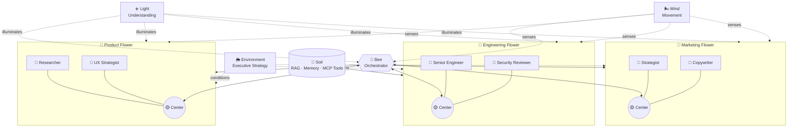

# 🌸 FOAA — Flower-Orchestrated Agent Architecture

> *A philosophy for coordinating many teams, many agents, and many subagents, learned from nature.*

**FOAA** (Flower-Orchestrated Agent Architecture) is a way to organize autonomous AI systems so they can grow without falling into chaos. It rests on five pillars:

**Governance · Coordination · Knowledge & Context · Guided Autonomy · Observability**

This repository holds the first **Python implementation** of FOAA. It turns the philosophy into something you can run, observe, and question.

---

## 🌼 The Idea

Imagine a field full of flowers.

So much is happening there that we can't even see it. For a moment we forget all of it, caught up in how beautiful the field is. But behind that beauty, the field never stops working. Roots draw from the soil. Bees carry pollen from one flower to the next. The wind moves through everything. The sun lights it all up.

Take away the sunlight and the field is still there, but we can no longer see it clearly. Flowers keep growing for a while on what they've stored. Then, slowly and without anyone noticing, things start to go wrong.

Autonomous multi-agent systems behave the same way. They can keep running for a long time with no visibility, no coordination, and no feedback. Tasks get done and messages get passed. Underneath, small mistakes pile up, drift spreads, and activity turns into noise.

FOAA starts from one question:

> **How should autonomy be organized so it can scale without losing coherence?**

The answer is not disorder, and it is not unlimited interaction between agents.
The answer is **orchestration**, and nature has been orchestrating for millions of years.

> 📖 *Curious about the philosophical approach behind FOAA? [Read the book on Amazon](https://a.co/d/0dV8GNbX).*

---

## 🌻 The Ecosystem

Every part of the field has a role in the architecture.

| In nature | In FOAA | Responsibility |
|---|---|---|
| 🌸 **Flower** | A team | A self-organized unit with its own purpose, coordinator, and specialists. |
| 🟡 **Flower center** | The team's coordinator (Product / Project / Domain Manager agent) | Turns goals into plans, delegates work, re-evaluates the results, and makes the final local decision. |
| 🌺 **Petals** | Specialist subagents | Each one has a clear, bounded role: a senior engineer, a marketing strategist, a security reviewer, a financial analyst... |
| 🌱 **Roots** | RAG and memory | Absorb knowledge from the soil. Over time, history teaches the system and makes the AI more efficient. |
| 🌿 **Branches** | MCP | Connect each flower to its surroundings: tools, APIs, databases, and services, reached through governed paths. |
| 🐝 **Bees** | Orchestrators (Programming Manager) | Travel from flower to flower, picking up "pollen" and leaving it behind. They carry context and value between teams. |
| 🌦️ **Environment** | Executive strategy (C-level) | Sun, rain, wind, storms, and seasons. It sets the conditions everything grows in, like the conductor of an orchestra. |
| 🌬️ **Wind** | Observer of movement | Watches everything that moves: load, drift, retries, friction, instability. |
| ☀️ **Light** | Observer of understanding | Shows the more "static" picture: decisions, evidence, quality, risk, cost, and overall health. |
| 👩‍🌾 **Gardener** | Human stewardship | Prepares the soil, watches for patterns, and steps in when needed, without micromanaging every petal. |

---

## 🌺 The Principles

### 1. The center gives meaning, not micromanagement
The center of a flower doesn't do all the work. It explains **why** the work exists. It takes in a goal, splits it into pieces, hands them to its petals, and then **reasons again** once the evidence comes back. A center that only forwards messages adds nothing. A center that tries to do everything becomes a bottleneck. A healthy center sits between the two.

### 2. Petals are focused, not diminished
A petal doesn't need to become the whole flower. Each specialist has **bounded autonomy**: real freedom to reason, inside clear limits on which tools, data, and actions it can use. A petal returns more than an answer. It also returns its **evidence, risks, and uncertainty**.

### 3. Roots and branches feed intelligence
- **RAG (roots)** answers: *What does this flower need to know right now?*
- **MCP (branches)** answers: *What can this flower reach, use, or activate?*

RAG feeds thinking. MCP feeds action. What the field learns goes back into the soil, after it has been filtered and validated, so the next season grows stronger.

### 4. Bees carry continuity, not control
A bee talks to the **center** of a flower, never directly to its petals. It routes work, decides the order, translates context between domains, spots conflicts, and combines results that no single flower could produce on its own. A bee coordinates the connections between flowers. It doesn't take over the flowers themselves.

### 5. The environment shapes conditions
Executives don't approve every action. They set the **climate**: priorities, risk appetite, budgets, compliance, and quality standards. Good local decisions then become the natural outcome. Strategy also learns: when many flowers show the same strain, the problem may be the climate, not the flowers.

### 6. Observers govern perception
> **Managers govern action. Observers govern perception.**

Wind shows what is changing and under strain. Light shows what can be understood. Observers **don't do the work themselves**. They alert, explain, and escalate, and the responsible center decides what to do. Without light, the field still exists, but it operates in the dark.

### 7. The same pattern at every scale
FOAA is **fractal**. A manager governs petals. A bee governs flowers. Higher-level flowers govern programs. The environment governs the portfolio. The size changes, but the shape stays the same. Across servers and regions, flowers talk through **event-driven contracts**, not hidden dependencies.

---

## 🐍 This Repository

`foaa-python` is the reference implementation of FOAA, currently **in early development**. The goal is to turn every element of the field (centers, petals, roots, branches, bees, environment, wind, and light) into practical, observable building blocks for real multi-agent systems.

Stay tuned: modules, examples, and documentation will grow here, season by season. 🌱

---

## 📖 The Book

The full philosophy, architecture, and reasoning behind FOAA are in the book:

**_Flower-Orchestrated Agent Architecture (FOAA): Governance, Architecture, and the Future of Autonomous Systems_**
by **Anderson Matheus Arruda**.

🌿 **Want to explore the philosophy behind FOAA in depth?** Read the book on Amazon: **[Flower-Orchestrated Agent Architecture](https://a.co/d/0dV8GNbX)**

> The book is copyrighted and is **not** included in this repository.

---

## 🌞 A Day in the Field: A Story

*The following story shows the ecosystem working well, from the first light of morning to the evening.*

### Dawn: The Climate Is Set

Before the first petal opens, the **environment** has already decided what kind of season this will be.

This quarter, the leadership of a small software company has chosen one direction: *"Make it easy for our customers to pay yearly instead of monthly. Grow, but don't let costs or security slip."*

No one is told which code to write or which slogan to use. The executives simply set the climate: a budget, a deadline, a strict security standard, and a clear message that experimenting is welcome as long as it stays visible.

The sun rises over the field.

### Morning: The Bee Takes Flight

A new objective lands in the ecosystem: **"Launch yearly subscription plans."**

The **bee** picks it up. It doesn't know how to build a billing system or write a campaign, and it doesn't need to. What it knows is *who* in the field can help, and in what order.

Before it flies, it reaches down into the **roots**. RAG brings back something valuable: three months ago another bee coordinated a pricing change, and the engineering flower ran into a tax-calculation problem with customers in other countries. The soil remembers. The bee writes a note: *"Ask about international tax early."*

Then it flies to three flowers:

- To the **Product Flower**: *"What do customers actually expect from a yearly plan?"*
- To the **Engineering Flower**: *"What would it take to support yearly billing safely?"*
- To the **Marketing Flower**: *"How do we tell this story once it's ready?"*

The bee never speaks to a petal directly. It lands on each **center**, leaves its pollen (the context, the constraints, the note about taxes), and moves on.

### Midday: The Flowers Bloom

In the **Product Flower**, the center reads the request and gives it meaning. It sends a *Research petal* to study customer feedback and a *UX Strategist petal* to sketch the upgrade flow. Both return their findings **with evidence**: "Customers want a clear discount, and they want to know they can cancel." The center weighs the two answers, notices they agree, and publishes its decision: **a 2-months-free discount, with cancellation clearly allowed.**

In the **Engineering Flower**, the center splits the work. A *Senior Engineer petal* designs the billing change. A *Security Reviewer petal*, with read-only access because its boundaries say so, inspects the payment flow. Through the **branches**, the petals reach the repository, the payment provider's sandbox, and the CI pipeline, all through governed MCP connections. Nothing touches the secrets folder. Nothing goes to production without review.

The Security petal returns a finding: *"Medium risk: refunds for annual plans aren't covered yet."* It doesn't hide the uncertainty. It names it.

The engineering center **reasons again**. With the new evidence, the plan changes: refund handling becomes part of the scope. That is the center doing its job, rebuilding its understanding once the specialists have changed what the flower knows.

In the **Marketing Flower**, a *Strategist petal* waits on purpose. Its center knows that announcing something before it's real would break the climate's rule: grow, but stay honest.

### Afternoon: The Wind Rises

A breeze moves across the field.

The **wind** notices something: the Engineering Flower's test runs are retrying again and again. Latency is going up. Twice in one hour, the same integration test fails, then passes, then fails.

The wind doesn't fix anything. That isn't its role. It simply makes the movement visible: *"Instability detected in the Engineering Flower: repeated retries on the tax integration."*

Then the **light** steps in. Because every action was recorded, with which flower acted, which petal, which context, and which tool, the light can show what is really going on. The failing tests are using an **outdated tax table** from the soil, the same kind of issue the roots had remembered that morning.

Now everyone can *see*.

- The **engineering center** pauses the task and asks its petals to use the current source.
- The **bee** checks the other flowers and confirms that Product and Marketing are not affected.
- **Governance** marks the outdated tax table as deprecated so no future flower drinks from it.
- The **gardener**, a human engineer, reviews the fix, approves it, and goes back to their coffee.

No panic. No blame. Just signal, understanding, decision, and correction.

### Late Afternoon: Pollination

With engineering stable and product decisions made, the bee flies again. This time it carries **results** instead of requests.

It brings the final pricing and the refund policy to the **Marketing Flower**. Now the Strategist petal works, and a *Copywriter petal* joins it. They write a message that is clear, honest, and consistent with what engineering actually built: *"Pay yearly, get two months free, cancel anytime."*

The bee gathers the three results and combines them into something none of the flowers could have produced alone: **a working feature, a validated price, and a launch message that tells the truth.**

It sends the result up to the environment. The executives see a single, clear view: the cost stayed within budget, security reviewed the risky parts, one incident was detected and fixed, and the launch is ready.

### Evening: The Soil Remembers

As the sun goes down, the field doesn't forget what it lived through.

The validated decisions, the corrected tax source, and the lesson *"annual plans need refund handling"* go back into the **soil**. Not everything is kept. The noise, the temporary drafts, and the failed retries are let go. Only what was **validated** becomes memory.

Next season, when another bee coordinates another launch, the roots will reach down and find this day waiting for them, ready to make the field a little wiser.

And somewhere beyond the field, the people who use the product simply notice a new option: *pay yearly, save more.* They will never see the bees, the petals, the wind, or the light.

That's how it should be.

**A healthy field doesn't ask to be admired for its machinery. It just blooms.** 🌸

---

## 👤 Author

**Anderson Matheus Arruda**: software engineer and technical strategist with more than two decades of experience in distributed systems, cloud, data, AI, and autonomous agent architectures.

- GitHub: [andmarruda/foaa-python](https://github.com/andmarruda/foaa-python)
- LinkedIn: [anderson-a-sborg](https://www.linkedin.com/in/anderson-a-sborg/)

---

<i>Intelligence without orchestration does not become wisdom. It becomes noise. FOAA exists to turn noise into organized life.</i>

