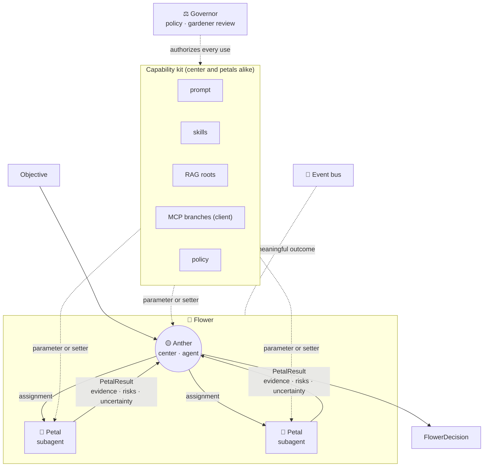

# FOAA Python: Architecture

This document explains how `foaa-python` is built and how it is designed to keep evolving.
It covers what exists today: **the flower**, made of a **center** (agent) and its **petals**
(subagents), with skills, RAG roots, MCP branches, governance, and events. Bees, environment,
soil, and the wind and light observers are planned next.

The rules behind every decision live in the
[constitution](../.specify/memory/constitution.md).

---

## 1. The shape of a flower



**Center and petal receive the same kit.** The only structural difference is the role:

| | Center (`Anther`) | Petal (`Petal`) |
|---|---|---|
| Calls and coordinates subagents | ✅ | ❌ never |
| Plans, reasons again, decides | ✅ | ❌ |
| Executes a specialty | ❌ (by default) | ✅ |
| Default policy | skills + RAG + **read-only** tools | skills + RAG, **no** tools |

### The center's cycle

1. **Plan.** The `PlanningStrategy` turns the objective into `Assignment`s.
2. **Validate.** Unknown petals, empty instructions, missing dependencies, and cycles are
   rejected before anything runs.
3. **Delegate.** Assignments run in dependency **waves**, in parallel inside each wave. A
   petal that depends on a failed one is *blocked*, not run blindly.
4. **Reason again (reinference).** The `ReinferenceStrategy` looks at the evidence and
   returns `complete`, `refine` (with feedback for specific petals), or `escalate`.
5. **Decide.** One `FlowerDecision` leaves the flower, always, even when planning or the
   model fails. In that case the decision is *escalated* with the reason.

### The petal's cycle

1. Retrieve the smallest relevant context from **allowed** RAG sources.
2. Build the system prompt from its prompt, its **allowed** skills, and the output contract.
3. Talk to the model, executing **governed** MCP tool calls, within step and tool budgets.
4. Return a `PetalResult`: conclusion, evidence, sources, risks, uncertainty, confidence,
   and the actions it performed. Failures are returned, not raised.

### Who executes a petal (ADR 0006)

The center depends only on `PetalPort`. **FOAA is not a harness**: the flower defines the
role, the policy, and the evidence contract; execution belongs to whatever runtime fits.

| Petal | Executes with | Governance |
|---|---|---|
| `ModelPetal` (alias `Petal`) | FOAA's native reference loop over a `ModelPort` | every call authorized as it happens |
| `HarnessPetal` | any `HarnessPort`: Claude Code, Agent SDK, Codex, LangGraph... | policy → `HarnessPermissions` before; reported actions audited after (`audit: post_hoc`) |
| `CommandPetal` | a `CommandRunner` (pytest, ruff, build) | `command/<program>` checked before it runs |

With deterministic strategies (`StaticPlanning`, `ThresholdReinference`,
`RepairLoopReinference`) the center needs no model at all.

---

## 2. Package map and layers

```
foaa/
├── common/            primitives: ids, clock, risk levels, errors          (layer 0)
├── adapters/          LLM adapters over user-owned clients                  (layer 4)
├── edd/               event envelope, catalog of event types, bus          (layer 1)
├── governance/        Policy, Governor, ReviewGate (the gardener)          (layer 2)
└── flowers/
    ├── common/        ModelPort, Skill, results, RunContext                (layer 3)
    ├── root/          Retriever port (RAG) + in-memory retriever           (layer 4)
    ├── branches/      McpConnection port + MCP SDK adapter (client only)   (layer 4)
    ├── runtime.py     CapabilityKit, Configurable, AgentHarness            (layer 5)
    ├── petals/        Petal                                                 (layer 6)
    └── anther/        Anther, planning and reinference strategies          (layer 7)
```

Each layer imports only from the layers below it. `tests/architecture/` fails the build if
that ever changes.

---

## 3. Evolutionary architecture

An evolutionary architecture is built to change safely and on purpose. FOAA uses five
mechanisms for that.

### 3.1 Fitness functions: the architecture is tested, not just described

`tests/architecture/` holds automated checks of the system's *shape*, each tied to a rule in
the constitution:

| Fitness function | Protects |
|---|---|
| `test_layers_only_depend_downwards` | the layer map above (no upward imports) |
| `test_core_is_provider_agnostic` | no LLM, vector store, broker, or MCP SDK in the core |
| `test_core_has_no_runtime_dependencies` | `dependencies = []` in `pyproject.toml` |
| `test_petals_never_coordinate_other_subagents` | only the center coordinates |
| `test_center_and_petal_share_the_same_capability_kit` | the same kit, by parameter or setter |
| `test_contracts.py` | event envelope fields, dotted event names, versioned contracts |

When the architecture *should* change, change the fitness function in the same commit, on
purpose. When it changes *by accident*, the build fails.

### 3.2 Ports and adapters: depend on capabilities, not vendors

Every external capability is a small `Protocol`:

| Port | One method to implement | Ships with |
|---|---|---|
| `ModelPort` | `complete(request) -> response` | `AnthropicModel`, `OpenAICompatibleModel`, `foaa.testing.ScriptedModel` ([contract](adapters.md)) |
| `Retriever` | `retrieve(query, limit)` | `InMemoryRetriever` |
| `McpConnection` | `list_tools()`, `call_tool()` | `InMemoryMcpConnection`, `McpSessionConnection` |
| `EventBus` | `publish()`, `subscribe()` | `InMemoryEventBus`, `NullEventBus` |
| `ReviewGate` | `review(request)` | `DenyAllReviewGate`, `ApproveAllReviewGate`, `CallbackReviewGate` |

New providers arrive as adapters with optional extras (`foaa[mcp]`, `foaa[anthropic]`,
`foaa[openai]` today; later perhaps `foaa[redis]`...), without touching flowers.

### 3.3 Strategies: the center's thinking can evolve

How a center plans and how it reasons again are strategies, swappable per flower:

| Strategy | Model-driven (default) | Deterministic |
|---|---|---|
| Planning | `ModelPlanning` | `StaticPlanning([Step(...)])` |
| Reinference | `ModelReinference` | `ThresholdReinference(escalate_at=..., min_confidence=...)` |

A team can start with a fixed pipeline and a rule-based evaluator, then move to model
planning, or the other way around, without rewriting the center.

### 3.4 Versioned contracts

`EventEnvelope`, `PetalResult`, and `FlowerDecision` carry a `schema_version`; every event
carries an `event_version`. Consumers can rely on the shape, and breaking changes must be
visible as version bumps (Constitution, Principle V).

### 3.5 Incremental growth

The single-process in-memory flower is the smallest complete unit. Distribution, bees,
observers, and soil plug in around it through the bus and the ports above, without
redesigning what already works.

---

## 4. Governance in practice

* **Deny by default.** No policy → `Policy.for_petal(...)` (no tools) or `Policy.for_center(...)`
  (read-only tools only).
* **Patterns.** `tools={"github/get_*"}`, `restricted={"*/delete_*"}`; `restricted` always wins.
* **Filtered before, checked during.** Tools the policy would deny are hidden from the model,
  and every call is authorized again when it happens.
* **Budgets.** `max_steps`, `max_tool_calls`, `max_retrieved_documents`.
* **The gardener.** `review_tools` block until a `ReviewGate` answers. Without a gate,
  the answer is *no*.
* **Every denial is an event** (`governance.action.denied`), so nothing fails silently.

---

## 5. Observability today

Every meaningful outcome is published as an `EventEnvelope` with `flower.id`, `agent.role`,
`agent.name`, `correlation_id` (the goal), and `causation_id`:

```
flower.objective.received → center.plan.created → petal.task.started → root.retrieval.completed
→ branch.tool.called → petal.task.completed → center.reinference.completed → flower.decision.published
```

Tool **argument values are never published**, only their keys, because they may be sensitive.
`InMemoryEventBus.history` / `.events(pattern, correlation_id=...)` already give you light
locally; the wind and light observers will consume the same stream.

---

## 6. Known limits and next steps

* LLM adapters ship for Claude (`AnthropicModel`) and any OpenAI-compatible API
  (`OpenAICompatibleModel`). For anything else, follow [the adapter contract](adapters.md) and
  run the conformance kit.
* `InMemoryRetriever` is keyword-based, meant for tests and tiny corpora.
* Simulated orchestrations live in `tests/orchestration/`, from one petal to a mini software
  factory, all with `foaa.testing.FakeHarness` / `FakeCommandRunner`.
* Real harness adapters (`foaa[claude-agent-sdk]`, ...) are next; they implement `HarnessPort`.
* Skills are injected into the system prompt; skill-bundled tools/scripts are not executed.
* The center's events and decisions are in memory; durable transports come with EDD work.
* Next ecosystem parts: bees (cross-flower), environment, soil (governed memory), observers.
