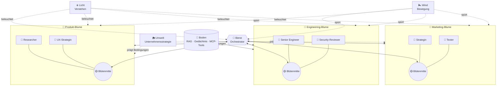

  🇺🇸 <a href="README.md">English</a> ·
  🇧🇷 <a href="readme-pt.md">Português</a> ·
  🇪🇸 <a href="readme-es.md">Español</a> ·
  🇳🇱 <a href="readme-nl.md">Nederlands</a> ·
  🇩🇪 <a href="readme-de.md">Deutsch</a>

# 🌸 FOAA — Flower-Orchestrated Agent Architecture

> *Eine Philosophie, von der Natur gelernt, um viele Teams, viele Agenten und viele Subagenten zu koordinieren.*

**FOAA** (Flower-Orchestrated Agent Architecture, auf Deutsch etwa „blumenorchestrierte Agentenarchitektur“) ist eine Art, autonome KI-Systeme so zu organisieren, dass sie wachsen können, ohne im Chaos zu versinken. Sie ruht auf fünf Säulen:

**Governance · Koordination · Wissen & Kontext · Geführte Autonomie · Beobachtbarkeit**

Dieses Repository enthält die erste **Python-Implementierung** von FOAA. Sie macht aus der Philosophie etwas, das man ausführen, beobachten und hinterfragen kann.

---

## 🌼 Die Idee

Stell dir eine Wiese voller Blumen vor.

Dort passiert so viel, dass wir es nicht einmal sehen können. Für einen Moment vergessen wir das alles, weil uns die Schönheit der Wiese gefangen nimmt. Doch hinter dieser Schönheit hört die Wiese nie auf zu arbeiten. Wurzeln schöpfen aus dem Boden. Bienen tragen Pollen von einer Blume zur nächsten. Der Wind streicht durch alles hindurch. Die Sonne lässt alles leuchten.

Nimm das Sonnenlicht weg, und die Wiese ist immer noch da, aber wir können sie nicht mehr klar erkennen. Die Blumen wachsen eine Weile weiter, von dem, was sie gespeichert haben. Dann beginnt langsam, und ohne dass es jemand bemerkt, etwas schiefzugehen.

Autonome Multi-Agenten-Systeme verhalten sich genauso. Sie können lange weiterlaufen, ohne Sichtbarkeit, ohne Koordination und ohne Rückmeldung. Aufgaben werden erledigt, Nachrichten werden weitergereicht. Darunter aber häufen sich kleine Fehler, Abweichungen breiten sich aus, und Aktivität wird zu Rauschen.

FOAA beginnt mit einer einzigen Frage:

> **Wie sollte Autonomie organisiert sein, damit sie skalieren kann, ohne ihre Kohärenz zu verlieren?**

Die Antwort ist nicht Unordnung, und sie ist auch nicht grenzenlose Interaktion zwischen Agenten.
Die Antwort ist **Orchestrierung**, und die Natur orchestriert seit Millionen von Jahren.

> 📖 *Neugierig auf den philosophischen Ansatz hinter FOAA? [Lies das Buch auf Amazon](https://a.co/d/0dV8GNbX).*

---

## 🌻 Das Ökosystem

Jeder Teil der Wiese hat eine Rolle in der Architektur.

| In der Natur | In FOAA | Verantwortung |
|---|---|---|
| 🌸 **Blume** | Ein Team | Eine selbstorganisierte Einheit mit eigenem Zweck, eigener Koordination und eigenen Spezialisten. |
| 🟡 **Blütenmitte** | Die Koordination des Teams (Product-/Project-/Domain-Manager-Agent) | Macht aus Zielen Pläne, delegiert Arbeit, bewertet die Ergebnisse neu und trifft die endgültige lokale Entscheidung. |
| 🌺 **Blütenblätter** | Spezialisierte Subagenten | Jedes hat eine klare, begrenzte Rolle: Senior Engineer, Marketingstrategin, Security-Reviewer, Finanzanalyst … |
| 🌱 **Wurzeln** | RAG und Gedächtnis | Nehmen Wissen aus dem Boden auf. Mit der Zeit lehrt die Geschichte das System und macht die KI effizienter. |
| 🌿 **Zweige** | MCP | Verbinden jede Blume mit ihrer Umgebung: Tools, APIs, Datenbanken und Dienste, erreichbar über kontrollierte Wege. |
| 🐝 **Bienen** | Orchestratoren (Programming Manager) | Fliegen von Blume zu Blume, nehmen „Pollen“ auf und lassen ihn zurück. Sie tragen Kontext und Wert zwischen den Teams. |
| 🌦️ **Umwelt** | Unternehmensstrategie (C-Level) | Sonne, Regen, Wind, Stürme und Jahreszeiten. Sie schafft die Bedingungen, unter denen alles wächst, wie der Dirigent eines Orchesters. |
| 🌬️ **Wind** | Beobachter der Bewegung | Behält alles im Blick, was sich bewegt: Last, Abweichungen, Wiederholungsversuche, Reibung, Instabilität. |
| ☀️ **Licht** | Beobachter des Verstehens | Zeigt das eher „statische“ Bild: Entscheidungen, Belege, Qualität, Risiko, Kosten und den Gesamtzustand. |
| 👩‍🌾 **Gärtner** | Menschliche Verantwortung | Bereitet den Boden vor, achtet auf Muster und greift ein, wenn es nötig ist, ohne jedes Blütenblatt zu bevormunden. |

---

## 🌺 Die Prinzipien

### 1. Die Blütenmitte stiftet Sinn, statt alles zu kontrollieren
Die Blütenmitte erledigt nicht die ganze Arbeit selbst. Sie erklärt, **warum** es die Arbeit gibt. Sie nimmt ein Ziel auf, zerlegt es in Teile, gibt diese an ihre Blütenblätter weiter und **denkt dann erneut nach**, sobald die Belege zurückkommen. Eine Blütenmitte, die nur Nachrichten weiterleitet, bringt nichts. Eine Blütenmitte, die alles selbst machen will, wird zum Flaschenhals. Eine gesunde Blütenmitte liegt dazwischen.

### 2. Blütenblätter sind fokussiert, nicht klein gemacht
Ein Blütenblatt muss nicht die ganze Blume werden. Jeder Spezialist hat **begrenzte Autonomie**: echte Freiheit zu denken, innerhalb klarer Grenzen dafür, welche Tools, Daten und Aktionen er nutzen darf. Ein Blütenblatt liefert mehr als eine Antwort. Es liefert auch seine **Belege, Risiken und Unsicherheiten**.

### 3. Wurzeln und Zweige nähren die Intelligenz
- **RAG (Wurzeln)** beantwortet: *Was muss diese Blume gerade jetzt wissen?*
- **MCP (Zweige)** beantwortet: *Was kann diese Blume erreichen, nutzen oder auslösen?*

RAG nährt das Denken. MCP nährt das Handeln. Was die Wiese lernt, fließt zurück in den Boden, nachdem es gefiltert und geprüft wurde, damit die nächste Saison kräftiger wächst.

### 4. Bienen tragen Kontinuität, nicht Kontrolle
Eine Biene spricht mit der **Blütenmitte** einer Blume, nie direkt mit ihren Blütenblättern. Sie leitet Arbeit weiter, legt die Reihenfolge fest, übersetzt Kontext zwischen Fachbereichen, erkennt Konflikte und führt Ergebnisse zusammen, die keine Blume allein hervorbringen könnte. Eine Biene koordiniert die Verbindungen zwischen den Blumen. Die Blumen selbst übernimmt sie nicht.

### 5. Die Umwelt prägt die Bedingungen
Führungskräfte genehmigen nicht jede einzelne Aktion. Sie bestimmen das **Klima**: Prioritäten, Risikobereitschaft, Budgets, Compliance und Qualitätsstandards. Gute lokale Entscheidungen sind dann die natürliche Folge. Auch die Strategie lernt dazu: Wenn viele Blumen dieselbe Belastung zeigen, liegt das Problem vielleicht am Klima und nicht an den Blumen.

### 6. Beobachter steuern die Wahrnehmung
> **Manager steuern das Handeln. Beobachter steuern die Wahrnehmung.**

Der Wind zeigt, was sich verändert und unter Druck steht. Das Licht zeigt, was sich verstehen lässt. Beobachter **erledigen die Arbeit nicht selbst**. Sie warnen, erklären und eskalieren, und die zuständige Blütenmitte entscheidet, was zu tun ist. Ohne Licht existiert die Wiese weiterhin, aber sie arbeitet im Dunkeln.

### 7. Dasselbe Muster in jedem Maßstab
FOAA ist **fraktal**. Ein Manager steuert Blütenblätter. Eine Biene steuert Blumen. Übergeordnete Blumen steuern Programme. Die Umwelt steuert das Portfolio. Die Größe ändert sich, die Form bleibt gleich. Über Server und Regionen hinweg kommunizieren Blumen über **ereignisgesteuerte Verträge**, nicht über versteckte Abhängigkeiten.

---

## 🐍 Dieses Repository

`foaa-python` ist die Referenzimplementierung von FOAA und befindet sich derzeit **in einer frühen Entwicklungsphase**. Ziel ist es, jedes Element der Wiese (Blütenmitten, Blütenblätter, Wurzeln, Zweige, Bienen, Umwelt, Wind und Licht) in praktische, beobachtbare Bausteine für echte Multi-Agenten-Systeme zu verwandeln.

Bleib dran: Module, Beispiele und Dokumentation werden hier wachsen, Saison für Saison. 🌱

---

## 📖 Das Buch

Die vollständige Philosophie, die Architektur und die Überlegungen hinter FOAA stehen im Buch:

**_Flower-Orchestrated Agent Architecture (FOAA): Governance, Architecture, and the Future of Autonomous Systems_**
von **Anderson Matheus Arruda**.

🌿 **Du möchtest tiefer in die Philosophie hinter FOAA eintauchen?** Lies das Buch auf Amazon: **[Flower-Orchestrated Agent Architecture](https://a.co/d/0dV8GNbX)**

> Das Buch ist urheberrechtlich geschützt und **nicht** Teil dieses Repositorys.

---

## 🌞 Ein Tag auf der Wiese: Eine Geschichte

*Die folgende Geschichte zeigt das Ökosystem, wenn es gut funktioniert, vom ersten Morgenlicht bis zum Abend.*

### Morgendämmerung: Das Klima wird bestimmt

Noch bevor sich das erste Blütenblatt öffnet, hat die **Umwelt** schon entschieden, was für eine Saison es werden soll.

In diesem Quartal hat die Führung eines kleinen Softwareunternehmens eine klare Richtung vorgegeben: *„Macht es unseren Kunden leicht, jährlich statt monatlich zu zahlen. Wachst, aber lasst Kosten und Sicherheit nicht schleifen.“*

Niemandem wird gesagt, welchen Code er schreiben oder welchen Slogan er verwenden soll. Die Führungskräfte bestimmen einfach das Klima: ein Budget, eine Deadline, einen strengen Sicherheitsstandard und die klare Botschaft, dass Experimente willkommen sind, solange sie sichtbar bleiben.

Die Sonne geht über der Wiese auf.

### Vormittag: Die Biene fliegt los

Ein neues Ziel landet im Ökosystem: **„Jahresabos einführen.“**

Die **Biene** nimmt es auf. Sie weiß nicht, wie man ein Abrechnungssystem baut oder eine Kampagne schreibt, und das muss sie auch nicht. Was sie weiß, ist, *wer* auf der Wiese helfen kann, und in welcher Reihenfolge.

Bevor sie losfliegt, greift sie hinab zu den **Wurzeln**. RAG bringt etwas Wertvolles zutage: Vor drei Monaten hat eine andere Biene eine Preisänderung koordiniert, und die Engineering-Blume stieß dabei auf ein Problem bei der Steuerberechnung für Kunden in anderen Ländern. Der Boden erinnert sich. Die Biene notiert sich: *„Früh nach internationalen Steuern fragen.“*

Dann fliegt sie zu drei Blumen:

- Zur **Produkt-Blume**: *„Was erwarten Kunden wirklich von einem Jahresabo?“*
- Zur **Engineering-Blume**: *„Was braucht es, um jährliche Abrechnung sicher zu unterstützen?“*
- Zur **Marketing-Blume**: *„Wie erzählen wir diese Geschichte, sobald alles bereit ist?“*

Die Biene spricht nie direkt mit einem Blütenblatt. Sie landet auf jeder **Blütenmitte**, lässt ihren Pollen zurück (den Kontext, die Rahmenbedingungen, die Notiz zu den Steuern) und fliegt weiter.

### Mittag: Die Blumen blühen auf

In der **Produkt-Blume** liest die Blütenmitte die Anfrage und gibt ihr Sinn. Sie schickt ein *Research-Blütenblatt* los, um Kundenfeedback auszuwerten, und ein *UX-Strategie-Blütenblatt*, um den Upgrade-Ablauf zu skizzieren. Beide liefern ihre Ergebnisse **mit Belegen**: „Kunden wollen einen klaren Rabatt, und sie wollen wissen, dass sie kündigen können.“ Die Blütenmitte wägt beide Antworten ab, stellt fest, dass sie übereinstimmen, und veröffentlicht ihre Entscheidung: **zwei Monate gratis, Kündigung ausdrücklich möglich.**

In der **Engineering-Blume** teilt die Blütenmitte die Arbeit auf. Ein *Senior-Engineer-Blütenblatt* entwirft die Änderung an der Abrechnung. Ein *Security-Reviewer-Blütenblatt*, nur mit Lesezugriff, weil seine Grenzen es so vorsehen, prüft den Zahlungsablauf. Über die **Zweige** erreichen die Blütenblätter das Repository, die Sandbox des Zahlungsanbieters und die CI-Pipeline, alles über kontrollierte MCP-Verbindungen. Nichts berührt den Ordner mit den Secrets. Nichts geht ohne Review in Produktion.

Das Security-Blütenblatt meldet einen Befund: *„Mittleres Risiko: Erstattungen für Jahresabos sind noch nicht abgedeckt.“* Es verschweigt die Unsicherheit nicht. Es benennt sie.

Die Engineering-Blütenmitte **denkt erneut nach**. Mit den neuen Belegen ändert sich der Plan: Der Umgang mit Erstattungen wird Teil des Umfangs. Genau das ist die Aufgabe der Blütenmitte: ihr Verständnis neu aufzubauen, sobald die Spezialisten verändert haben, was die Blume weiß.

In der **Marketing-Blume** wartet ein *Strategie-Blütenblatt* ganz bewusst. Seine Blütenmitte weiß, dass eine Ankündigung, bevor etwas wirklich existiert, gegen die Regel des Klimas verstoßen würde: Wachsen, aber ehrlich bleiben.

### Nachmittag: Der Wind kommt auf

Eine Brise zieht über die Wiese.

Der **Wind** bemerkt etwas: Die Testläufe der Engineering-Blume wiederholen sich immer und immer wieder. Die Latenz steigt. Zweimal innerhalb einer Stunde schlägt derselbe Integrationstest fehl, läuft dann durch, schlägt dann wieder fehl.

Der Wind repariert nichts. Das ist nicht seine Rolle. Er macht die Bewegung einfach sichtbar: *„Instabilität in der Engineering-Blume erkannt: wiederholte Retries bei der Steuer-Integration.“*

Dann tritt das **Licht** hinzu. Weil jede Aktion aufgezeichnet wurde, also welche Blume gehandelt hat, welches Blütenblatt, mit welchem Kontext und welchem Tool, kann das Licht zeigen, was wirklich los ist. Die fehlschlagenden Tests verwenden eine **veraltete Steuertabelle** aus dem Boden, genau die Art von Problem, an die sich die Wurzeln am Morgen erinnert hatten.

Jetzt können alle *sehen*.

- Die **Engineering-Blütenmitte** pausiert die Aufgabe und bittet ihre Blütenblätter, die aktuelle Quelle zu verwenden.
- Die **Biene** prüft die anderen Blumen und bestätigt, dass Produkt und Marketing nicht betroffen sind.
- Die **Governance** markiert die veraltete Steuertabelle als überholt, damit keine Blume mehr aus ihr trinkt.
- Der **Gärtner**, ein menschlicher Engineer, prüft die Korrektur, gibt sie frei und widmet sich wieder seinem Kaffee.

Keine Panik. Keine Schuldzuweisungen. Nur Signal, Verständnis, Entscheidung und Korrektur.

### Später Nachmittag: Bestäubung

Das Engineering ist stabil, die Produktentscheidungen sind getroffen, und die Biene fliegt erneut los. Diesmal trägt sie **Ergebnisse** statt Anfragen.

Sie bringt den finalen Preis und die Erstattungsregelung zur **Marketing-Blume**. Jetzt legt das Strategie-Blütenblatt los, und ein *Texter-Blütenblatt* kommt hinzu. Gemeinsam schreiben sie eine Botschaft, die klar, ehrlich und im Einklang mit dem ist, was das Engineering tatsächlich gebaut hat: *„Jährlich zahlen, zwei Monate geschenkt, jederzeit kündbar.“*

Die Biene sammelt die drei Ergebnisse und fügt sie zu etwas zusammen, das keine der Blumen allein hätte schaffen können: **ein funktionierendes Feature, ein geprüfter Preis und eine Launch-Botschaft, die die Wahrheit sagt.**

Sie schickt das Ergebnis hinauf zur Umwelt. Die Führungskräfte sehen ein einziges, klares Bild: Die Kosten sind im Budget geblieben, die Sicherheit hat die riskanten Stellen geprüft, ein Vorfall wurde erkannt und behoben, und der Launch ist bereit.

### Abend: Der Boden erinnert sich

Während die Sonne untergeht, vergisst die Wiese nicht, was sie erlebt hat.

Die geprüften Entscheidungen, die korrigierte Steuerquelle und die Lektion *„Jahresabos brauchen eine Erstattungsregelung“* fließen zurück in den **Boden**. Nicht alles wird behalten. Das Rauschen, die vorläufigen Entwürfe und die gescheiterten Wiederholungsversuche dürfen gehen. Nur was **geprüft** wurde, wird zu Erinnerung.

In der nächsten Saison, wenn eine andere Biene einen anderen Launch koordiniert, werden die Wurzeln hinabreichen und diesen Tag dort vorfinden, bereit, die Wiese ein wenig weiser zu machen.

Und irgendwo jenseits der Wiese bemerken die Menschen, die das Produkt nutzen, einfach eine neue Option: *jährlich zahlen, mehr sparen.* Sie werden nie die Bienen sehen, die Blütenblätter, den Wind oder das Licht.

Genau so soll es sein.

**Eine gesunde Wiese will nicht für ihre Mechanik bewundert werden. Sie blüht einfach.** 🌸

---

## 📜 Lizenz

Der Quellcode in diesem Repository wird unter der [MIT-Lizenz](LICENSE) veröffentlicht.

Das Buch *Flower-Orchestrated Agent Architecture (FOAA)* fällt **nicht** unter diese Lizenz. Es bleibt © Anderson Matheus Arruda, alle Rechte vorbehalten.

---

## 👤 Autor

**Anderson Matheus Arruda**: Softwareingenieur und technischer Stratege mit mehr als zwei Jahrzehnten Erfahrung in verteilten Systemen, Cloud, Daten, KI und Architekturen für autonome Agenten.

- GitHub: [andmarruda/foaa-python](https://github.com/andmarruda/foaa-python)
- LinkedIn: [anderson-a-sborg](https://www.linkedin.com/in/anderson-a-sborg/)

---

<i>Intelligenz ohne Orchestrierung wird nicht zu Weisheit. Sie wird zu Rauschen. FOAA existiert, um Rauschen in organisiertes Leben zu verwandeln.</i>

