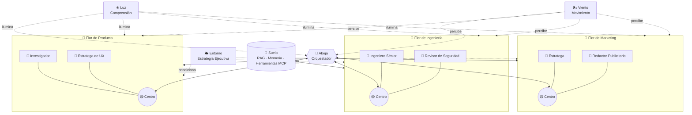

  🇺🇸 <a href="README.md">English</a> ·
  🇧🇷 <a href="readme-pt.md">Português</a> ·
  🇪🇸 <a href="readme-es.md">Español</a> ·
  🇳🇱 <a href="readme-nl.md">Nederlands</a> ·
  🇩🇪 <a href="readme-de.md">Deutsch</a>

# 🌸 FOAA — Flower-Orchestrated Agent Architecture

> *Una filosofía para coordinar muchos equipos, muchos agentes y muchos subagentes, aprendida de la naturaleza.*

**FOAA** (Flower-Orchestrated Agent Architecture, o Arquitectura de Agentes Orquestada por Flores) es una forma de organizar sistemas autónomos de IA para que puedan crecer sin caer en el caos. Se apoya en cinco pilares:

**Gobernanza · Coordinación · Conocimiento y Contexto · Autonomía Guiada · Observabilidad**

Este repositorio contiene la primera **implementación en Python** de FOAA. Convierte la filosofía en algo que se puede ejecutar, observar y cuestionar.

---

## 🌼 La idea

Imagina un campo lleno de flores.

Allí ocurren tantas cosas que ni siquiera alcanzamos a verlas. Por un momento lo olvidamos todo, absortos en la belleza del campo. Pero detrás de esa belleza, el campo nunca deja de trabajar. Las raíces se nutren del suelo. Las abejas llevan el polen de una flor a otra. El viento lo recorre todo. El sol lo ilumina todo.

Si quitamos la luz del sol, el campo sigue ahí, pero ya no podemos verlo con claridad. Las flores siguen creciendo un tiempo con lo que tienen guardado. Después, poco a poco y sin que nadie lo note, las cosas empiezan a salir mal.

Los sistemas autónomos multiagente se comportan del mismo modo. Pueden seguir funcionando durante mucho tiempo sin visibilidad, sin coordinación y sin retroalimentación. Las tareas se completan y los mensajes circulan. Por debajo, los pequeños errores se acumulan, las desviaciones se propagan y la actividad se convierte en ruido.

FOAA parte de una pregunta:

> **¿Cómo debe organizarse la autonomía para que pueda escalar sin perder coherencia?**

La respuesta no es el desorden, ni tampoco la interacción ilimitada entre agentes.
La respuesta es la **orquestación**, y la naturaleza lleva millones de años orquestando.

> 📖 *¿Te interesa el enfoque filosófico detrás de FOAA? [Lee el libro en Amazon](https://a.co/d/0dV8GNbX).*

---

## 🌻 El ecosistema

Cada parte del campo cumple un papel en la arquitectura.

| En la naturaleza | En FOAA | Responsabilidad |
|---|---|---|
| 🌸 **Flor** | Un equipo | Una unidad autoorganizada con su propio propósito, coordinador y especialistas. |
| 🟡 **Centro de la flor** | El coordinador del equipo (agente Product / Project / Domain Manager) | Convierte los objetivos en planes, delega el trabajo, reevalúa los resultados y toma la decisión local final. |
| 🌺 **Pétalos** | Subagentes especialistas | Cada uno tiene un rol claro y acotado: un ingeniero sénior, un estratega de marketing, un revisor de seguridad, un analista financiero... |
| 🌱 **Raíces** | RAG y memoria | Absorben el conocimiento del suelo. Con el tiempo, la historia enseña al sistema y hace que la IA sea más eficiente. |
| 🌿 **Ramas** | MCP | Conectan cada flor con su entorno inmediato: herramientas, APIs, bases de datos y servicios, a los que se llega por caminos gobernados. |
| 🐝 **Abejas** | Orquestadores (Programming Manager) | Viajan de flor en flor, recogiendo "polen" y dejándolo a su paso. Llevan contexto y valor entre los equipos. |
| 🌦️ **Entorno** | Estrategia ejecutiva (C-level) | Sol, lluvia, viento, tormentas y estaciones. Define las condiciones en las que todo crece, como el director de una orquesta. |
| 🌬️ **Viento** | Observador del movimiento | Vigila todo lo que se mueve: carga, desviaciones, reintentos, fricción, inestabilidad. |
| ☀️ **Luz** | Observador de la comprensión | Muestra la imagen más "estática": decisiones, evidencias, calidad, riesgo, costo y salud general. |
| 👩‍🌾 **Jardinero** | Supervisión humana | Prepara el suelo, observa los patrones e interviene cuando hace falta, sin microgestionar cada pétalo. |

---

## 🌺 Los principios

### 1. El centro da sentido, no microgestiona
El centro de una flor no hace todo el trabajo. Explica **por qué** existe ese trabajo. Recibe un objetivo, lo divide en partes, las reparte entre sus pétalos y luego **vuelve a razonar** cuando llegan las evidencias. Un centro que solo reenvía mensajes no aporta nada. Un centro que intenta hacerlo todo se convierte en un cuello de botella. Un centro sano se sitúa entre ambos extremos.

### 2. Los pétalos están enfocados, no disminuidos
Un pétalo no necesita convertirse en la flor entera. Cada especialista tiene **autonomía acotada**: libertad real para razonar, dentro de límites claros sobre qué herramientas, datos y acciones puede usar. Un pétalo devuelve algo más que una respuesta. También devuelve sus **evidencias, riesgos e incertidumbres**.

### 3. Las raíces y las ramas alimentan la inteligencia
- **RAG (raíces)** responde: *¿Qué necesita saber esta flor ahora mismo?*
- **MCP (ramas)** responde: *¿Qué puede alcanzar, usar o activar esta flor?*

RAG alimenta el pensamiento. MCP alimenta la acción. Lo que el campo aprende vuelve al suelo, después de ser filtrado y validado, para que la próxima estación crezca con más fuerza.

### 4. Las abejas llevan continuidad, no control
Una abeja habla con el **centro** de una flor, nunca directamente con sus pétalos. Enruta el trabajo, decide el orden, traduce el contexto entre dominios, detecta conflictos y combina resultados que ninguna flor podría producir por sí sola. Una abeja coordina las conexiones entre las flores. No se adueña de las flores en sí.

### 5. El entorno moldea las condiciones
Los ejecutivos no aprueban cada acción. Definen el **clima**: prioridades, apetito de riesgo, presupuestos, cumplimiento normativo y estándares de calidad. Así, las buenas decisiones locales se vuelven el resultado natural. La estrategia también aprende: cuando muchas flores muestran la misma tensión, el problema puede estar en el clima, no en las flores.

### 6. Los observadores gobiernan la percepción
> **Los gestores gobiernan la acción. Los observadores gobiernan la percepción.**

El viento muestra lo que está cambiando y lo que está bajo tensión. La luz muestra lo que se puede comprender. Los observadores **no hacen el trabajo por sí mismos**. Alertan, explican y escalan, y el centro responsable decide qué hacer. Sin luz, el campo sigue existiendo, pero opera a oscuras.

### 7. El mismo patrón a cualquier escala
FOAA es **fractal**. Un gestor gobierna pétalos. Una abeja gobierna flores. Las flores de nivel superior gobiernan programas. El entorno gobierna el portafolio. El tamaño cambia, pero la forma se mantiene. Entre servidores y regiones, las flores se comunican mediante **contratos orientados a eventos**, no mediante dependencias ocultas.

---

## 🐍 Este repositorio

`foaa-python` es la implementación de referencia de FOAA, actualmente **en una etapa temprana de desarrollo**. El objetivo es convertir cada elemento del campo (centros, pétalos, raíces, ramas, abejas, entorno, viento y luz) en bloques prácticos y observables para construir sistemas multiagente reales.

Mantente atento: los módulos, los ejemplos y la documentación irán creciendo aquí, estación tras estación. 🌱

---

## 📖 El libro

La filosofía completa, la arquitectura y el razonamiento detrás de FOAA están en el libro:

**_Flower-Orchestrated Agent Architecture (FOAA): Governance, Architecture, and the Future of Autonomous Systems_**
de **Anderson Matheus Arruda**.

🌿 **¿Quieres explorar a fondo la filosofía detrás de FOAA?** Lee el libro en Amazon: **[Flower-Orchestrated Agent Architecture](https://a.co/d/0dV8GNbX)**

> El libro está protegido por derechos de autor y **no** está incluido en este repositorio.

---

## 🌞 Un día en el campo: una historia

*La siguiente historia muestra el ecosistema funcionando bien, desde la primera luz de la mañana hasta el anochecer.*

### Amanecer: se define el clima

Antes de que se abra el primer pétalo, el **entorno** ya ha decidido qué tipo de estación será.

Este trimestre, la dirección de una pequeña empresa de software ha elegido un único rumbo: *"Que a nuestros clientes les resulte fácil pagar de forma anual en lugar de mensual. Crecer, sí, pero sin descuidar los costos ni la seguridad."*

A nadie se le dice qué código escribir ni qué eslogan usar. Los ejecutivos simplemente definen el clima: un presupuesto, un plazo, un estándar de seguridad estricto y un mensaje claro de que experimentar es bienvenido, siempre que se haga a la vista.

El sol se eleva sobre el campo.

### Mañana: la abeja alza el vuelo

Un nuevo objetivo llega al ecosistema: **"Lanzar planes de suscripción anual."**

La **abeja** lo recoge. No sabe cómo construir un sistema de facturación ni cómo escribir una campaña, y no le hace falta. Lo que sabe es *quién* en el campo puede ayudar, y en qué orden.

Antes de volar, desciende hasta las **raíces**. RAG le devuelve algo valioso: hace tres meses, otra abeja coordinó un cambio de precios, y la flor de ingeniería se topó con un problema en el cálculo de impuestos para clientes de otros países. El suelo recuerda. La abeja toma nota: *"Preguntar pronto por los impuestos internacionales."*

Luego vuela hacia tres flores:

- A la **Flor de Producto**: *"¿Qué esperan realmente los clientes de un plan anual?"*
- A la **Flor de Ingeniería**: *"¿Qué haría falta para soportar la facturación anual de forma segura?"*
- A la **Flor de Marketing**: *"¿Cómo contamos esta historia cuando esté lista?"*

La abeja nunca habla directamente con un pétalo. Se posa en cada **centro**, deja su polen (el contexto, las restricciones, la nota sobre los impuestos) y sigue su camino.

### Mediodía: las flores florecen

En la **Flor de Producto**, el centro lee la solicitud y le da sentido. Envía a un *pétalo de Investigación* a estudiar los comentarios de los clientes y a un *pétalo Estratega de UX* a bosquejar el flujo de actualización del plan. Ambos devuelven sus hallazgos **con evidencias**: "Los clientes quieren un descuento claro y quieren saber que pueden cancelar." El centro sopesa las dos respuestas, nota que coinciden y publica su decisión: **un descuento de 2 meses gratis, con la cancelación claramente permitida.**

En la **Flor de Ingeniería**, el centro divide el trabajo. Un *pétalo Ingeniero Sénior* diseña el cambio en la facturación. Un *pétalo Revisor de Seguridad*, con acceso de solo lectura porque así lo establecen sus límites, inspecciona el flujo de pagos. A través de las **ramas**, los pétalos llegan al repositorio, al entorno de pruebas del proveedor de pagos y al pipeline de CI, siempre mediante conexiones MCP gobernadas. Nada toca la carpeta de secretos. Nada llega a producción sin revisión.

El pétalo de Seguridad devuelve un hallazgo: *"Riesgo medio: los reembolsos de los planes anuales todavía no están contemplados."* No oculta la incertidumbre. La nombra.

El centro de ingeniería **vuelve a razonar**. Con la nueva evidencia, el plan cambia: la gestión de reembolsos pasa a formar parte del alcance. Eso es el centro haciendo su trabajo: reconstruir su comprensión cuando los especialistas han cambiado lo que la flor sabe.

En la **Flor de Marketing**, un *pétalo Estratega* espera a propósito. Su centro sabe que anunciar algo antes de que sea real rompería la regla del clima: crecer, pero con honestidad.

### Tarde: se levanta el viento

Una brisa recorre el campo.

El **viento** advierte algo: las ejecuciones de pruebas de la Flor de Ingeniería se reintentan una y otra vez. La latencia sube. Dos veces en una hora, la misma prueba de integración falla, luego pasa, luego vuelve a fallar.

El viento no arregla nada. Ese no es su papel. Simplemente hace visible el movimiento: *"Inestabilidad detectada en la Flor de Ingeniería: reintentos repetidos en la integración de impuestos."*

Entonces entra la **luz**. Como cada acción quedó registrada, con qué flor actuó, qué pétalo, qué contexto y qué herramienta, la luz puede mostrar lo que realmente está pasando. Las pruebas que fallan están usando una **tabla de impuestos desactualizada** del suelo, el mismo tipo de problema que las raíces habían recordado esa mañana.

Ahora todos pueden *ver*.

- El **centro de ingeniería** pausa la tarea y pide a sus pétalos que usen la fuente actualizada.
- La **abeja** revisa las demás flores y confirma que Producto y Marketing no se ven afectados.
- La **gobernanza** marca la tabla de impuestos desactualizada como obsoleta para que ninguna flor futura vuelva a beber de ella.
- El **jardinero**, un ingeniero humano, revisa la corrección, la aprueba y vuelve a su café.

Sin pánico. Sin culpas. Solo señal, comprensión, decisión y corrección.

### Atardecer: la polinización

Con la ingeniería estable y las decisiones de producto tomadas, la abeja vuelve a volar. Esta vez lleva **resultados** en lugar de solicitudes.

Lleva el precio final y la política de reembolsos a la **Flor de Marketing**. Ahora el pétalo Estratega se pone a trabajar, y se le une un *pétalo Redactor Publicitario*. Juntos escriben un mensaje claro, honesto y coherente con lo que ingeniería realmente construyó: *"Paga anualmente, llévate dos meses gratis y cancela cuando quieras."*

La abeja reúne los tres resultados y los combina en algo que ninguna de las flores habría podido producir sola: **una funcionalidad que funciona, un precio validado y un mensaje de lanzamiento que dice la verdad.**

Envía el resultado hacia el entorno. Los ejecutivos ven una única visión clara: el costo se mantuvo dentro del presupuesto, seguridad revisó las partes delicadas, se detectó y corrigió un incidente, y el lanzamiento está listo.

### Anochecer: el suelo recuerda

Mientras el sol se pone, el campo no olvida lo que vivió.

Las decisiones validadas, la fuente de impuestos corregida y la lección *"los planes anuales necesitan gestión de reembolsos"* vuelven al **suelo**. No todo se conserva. El ruido, los borradores temporales y los reintentos fallidos se dejan ir. Solo lo que fue **validado** se convierte en memoria.

La próxima estación, cuando otra abeja coordine otro lanzamiento, las raíces descenderán y encontrarán este día esperándolas, listo para hacer el campo un poco más sabio.

Y en algún lugar más allá del campo, las personas que usan el producto simplemente notan una nueva opción: *paga anualmente, ahorra más.* Nunca verán las abejas, los pétalos, el viento ni la luz.

Así es como debe ser.

**Un campo sano no pide que admiren su maquinaria. Simplemente florece.** 🌸

---

## 📜 Licencia

El código fuente de este repositorio se publica bajo la [Licencia MIT](LICENSE).

El libro *Flower-Orchestrated Agent Architecture (FOAA)* **no** está cubierto por esta licencia. Sigue siendo © Anderson Matheus Arruda, todos los derechos reservados.

---

## 👤 Autor

**Anderson Matheus Arruda**: ingeniero de software y estratega técnico con más de dos décadas de experiencia en sistemas distribuidos, nube, datos, IA y arquitecturas de agentes autónomos.

- GitHub: [andmarruda/foaa-python](https://github.com/andmarruda/foaa-python)
- LinkedIn: [anderson-a-sborg](https://www.linkedin.com/in/anderson-a-sborg/)

---

<i>La inteligencia sin orquestación no se convierte en sabiduría. Se convierte en ruido. FOAA existe para convertir el ruido en vida organizada.</i>

