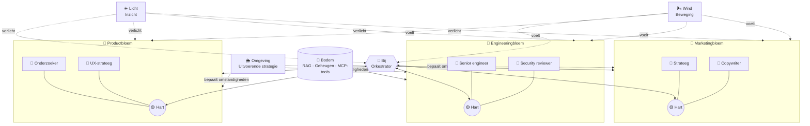

  🇺🇸 <a href="README.md">English</a> ·
  🇧🇷 <a href="readme-pt.md">Português</a> ·
  🇪🇸 <a href="readme-es.md">Español</a> ·
  🇳🇱 <a href="readme-nl.md">Nederlands</a> ·
  🇩🇪 <a href="readme-de.md">Deutsch</a>

# 🌸 FOAA — Flower-Orchestrated Agent Architecture

> *Een filosofie voor het coördineren van veel teams, veel agents en veel subagents, geleerd van de natuur.*

**FOAA** (Flower-Orchestrated Agent Architecture, oftewel een door bloemen georkestreerde agentarchitectuur) is een manier om autonome AI-systemen zo te organiseren dat ze kunnen groeien zonder in chaos te vervallen. De aanpak rust op vijf pijlers:

**Governance · Coördinatie · Kennis & context · Begeleide autonomie · Observeerbaarheid**

Deze repository bevat de eerste **Python-implementatie** van FOAA. Hier wordt de filosofie iets wat je kunt draaien, observeren en bevragen.

---

## 🌼 Het idee

Stel je een veld vol bloemen voor.

Er gebeurt daar zoveel dat we het niet eens kunnen zien. Even vergeten we het allemaal, betoverd door hoe mooi het veld is. Maar achter die schoonheid staat het veld nooit stil. Wortels putten uit de bodem. Bijen dragen stuifmeel van de ene bloem naar de volgende. De wind beweegt door alles heen. De zon zet alles in het licht.

Neem het zonlicht weg en het veld is er nog steeds, maar we kunnen het niet meer helder zien. De bloemen groeien nog een tijdje door op wat ze hebben opgeslagen. Dan begint het, langzaam en zonder dat iemand het merkt, mis te gaan.

Autonome multi-agentsystemen gedragen zich precies zo. Ze kunnen lange tijd blijven draaien zonder zicht, zonder coördinatie en zonder feedback. Taken worden afgerond en berichten worden doorgegeven. Maar onder de oppervlakte stapelen kleine fouten zich op, verspreidt afwijking zich en verandert activiteit in ruis.

FOAA begint met één vraag:

> **Hoe moet autonomie georganiseerd worden zodat ze kan opschalen zonder haar samenhang te verliezen?**

Het antwoord is geen wanorde, en ook geen onbeperkte interactie tussen agents.
Het antwoord is **orkestratie**, en de natuur orkestreert al miljoenen jaren.

> 📖 *Benieuwd naar de filosofische benadering achter FOAA? [Lees het boek op Amazon](https://a.co/d/0dV8GNbX).*

---

## 🌻 Het ecosysteem

Elk deel van het veld heeft een rol in de architectuur.

| In de natuur | In FOAA | Verantwoordelijkheid |
|---|---|---|
| 🌸 **Bloem** | Een team | Een zelforganiserende eenheid met een eigen doel, een eigen coördinator en eigen specialisten. |
| 🟡 **Bloemhart** | De coördinator van het team (Product-, Project- of Domeinmanager-agent) | Vertaalt doelen naar plannen, delegeert werk, beoordeelt de resultaten opnieuw en neemt de uiteindelijke lokale beslissing. |
| 🌺 **Bloembladen** | Gespecialiseerde subagents | Elk met een duidelijke, afgebakende rol: een senior engineer, een marketingstrateeg, een security reviewer, een financieel analist... |
| 🌱 **Wortels** | RAG en geheugen | Nemen kennis op uit de bodem. Na verloop van tijd leert de geschiedenis het systeem bij en wordt de AI efficiënter. |
| 🌿 **Takken** | MCP | Verbinden elke bloem met haar omgeving: tools, API's, databases en services, bereikbaar via beheerde paden. |
| 🐝 **Bijen** | Orkestrators (Programmamanager) | Vliegen van bloem naar bloem, nemen "stuifmeel" mee en laten het achter. Ze dragen context en waarde over tussen teams. |
| 🌦️ **Omgeving** | Uitvoerende strategie (C-level) | Zon, regen, wind, stormen en seizoenen. Zij bepaalt de omstandigheden waarin alles groeit, als de dirigent van een orkest. |
| 🌬️ **Wind** | Waarnemer van beweging | Houdt alles in de gaten wat beweegt: belasting, afwijking, herhaalpogingen, frictie, instabiliteit. |
| ☀️ **Licht** | Waarnemer van inzicht | Toont het meer "statische" beeld: beslissingen, bewijs, kwaliteit, risico, kosten en de algehele gezondheid. |
| 👩‍🌾 **Tuinier** | Menselijk rentmeesterschap | Bereidt de bodem voor, let op patronen en grijpt in waar nodig, zonder elk bloemblad te micromanagen. |

---

## 🌺 De principes

### 1. Het hart geeft betekenis, geen micromanagement
Het hart van een bloem doet niet al het werk. Het legt uit **waarom** het werk bestaat. Het neemt een doel in ontvangst, deelt het op in stukken, geeft die aan zijn bloembladen en **denkt opnieuw na** zodra het bewijs terugkomt. Een hart dat alleen berichten doorstuurt, voegt niets toe. Een hart dat alles zelf probeert te doen, wordt een knelpunt. Een gezond hart zit daar tussenin.

### 2. Bloembladen zijn gefocust, niet verkleind
Een bloemblad hoeft niet de hele bloem te worden. Elke specialist heeft **begrensde autonomie**: echte vrijheid om te redeneren, binnen duidelijke grenzen voor de tools, data en acties die het mag gebruiken. Een bloemblad levert meer op dan een antwoord. Het geeft ook zijn **bewijs, risico's en onzekerheid** terug.

### 3. Wortels en takken voeden de intelligentie
- **RAG (wortels)** beantwoordt: *Wat moet deze bloem op dit moment weten?*
- **MCP (takken)** beantwoordt: *Wat kan deze bloem bereiken, gebruiken of in gang zetten?*

RAG voedt het denken. MCP voedt het handelen. Wat het veld leert, gaat terug de bodem in, nadat het gefilterd en gevalideerd is, zodat het volgende seizoen sterker groeit.

### 4. Bijen dragen continuïteit, geen controle
Een bij praat met het **hart** van een bloem, nooit rechtstreeks met haar bloembladen. Ze routeert werk, bepaalt de volgorde, vertaalt context tussen domeinen, signaleert conflicten en combineert resultaten die geen enkele bloem in haar eentje had kunnen voortbrengen. Een bij coördineert de verbindingen tussen bloemen. Ze neemt de bloemen zelf niet over.

### 5. De omgeving vormt de omstandigheden
Bestuurders keuren niet elke actie goed. Ze bepalen het **klimaat**: prioriteiten, risicobereidheid, budgetten, compliance en kwaliteitsnormen. Goede lokale beslissingen worden dan de natuurlijke uitkomst. Ook de strategie leert: wanneer veel bloemen dezelfde spanning vertonen, ligt het probleem misschien bij het klimaat, niet bij de bloemen.

### 6. Waarnemers sturen de waarneming
> **Managers sturen het handelen. Waarnemers sturen de waarneming.**

De wind laat zien wat verandert en onder druk staat. Het licht laat zien wat begrepen kan worden. Waarnemers **doen het werk niet zelf**. Ze waarschuwen, verklaren en escaleren, en het verantwoordelijke hart beslist wat er gebeurt. Zonder licht bestaat het veld nog steeds, maar het werkt in het donker.

### 7. Hetzelfde patroon op elke schaal
FOAA is **fractaal**. Een manager stuurt bloembladen aan. Een bij stuurt bloemen aan. Bloemen op een hoger niveau sturen programma's aan. De omgeving stuurt de portefeuille aan. De grootte verandert, maar de vorm blijft gelijk. Over servers en regio's heen communiceren bloemen via **event-driven contracten**, niet via verborgen afhankelijkheden.

---

## 🐍 Deze repository

`foaa-python` is de referentie-implementatie van FOAA en bevindt zich momenteel **in een vroege ontwikkelfase**. Het doel is om elk element van het veld (harten, bloembladen, wortels, takken, bijen, omgeving, wind en licht) om te zetten in praktische, observeerbare bouwstenen voor echte multi-agentsystemen.

Blijf op de hoogte: modules, voorbeelden en documentatie groeien hier, seizoen na seizoen. 🌱

---

## 📖 Het boek

De volledige filosofie, architectuur en redenering achter FOAA staan in het boek:

**_Flower-Orchestrated Agent Architecture (FOAA): Governance, Architecture, and the Future of Autonomous Systems_**
door **Anderson Matheus Arruda**.

🌿 **Wil je de filosofie achter FOAA grondig verkennen?** Lees het boek op Amazon: **[Flower-Orchestrated Agent Architecture](https://a.co/d/0dV8GNbX)**

> Het boek is auteursrechtelijk beschermd en maakt **geen** deel uit van deze repository.

---

## 🌞 Een dag in het veld: een verhaal

*Het volgende verhaal laat zien hoe het ecosysteem goed functioneert, van het eerste ochtendlicht tot de avond.*

### Dageraad: het klimaat wordt bepaald

Nog voordat het eerste bloemblad opengaat, heeft de **omgeving** al besloten wat voor seizoen het wordt.

Dit kwartaal heeft de directie van een klein softwarebedrijf één richting gekozen: *"Maak het voor onze klanten makkelijk om per jaar te betalen in plaats van per maand. Groei, maar laat de kosten en de beveiliging niet verslappen."*

Niemand krijgt te horen welke code hij moet schrijven of welke slogan hij moet gebruiken. De bestuurders bepalen simpelweg het klimaat: een budget, een deadline, een strenge beveiligingsnorm en de duidelijke boodschap dat experimenteren welkom is, zolang het zichtbaar blijft.

De zon komt op boven het veld.

### Ochtend: de bij vliegt uit

Er landt een nieuwe doelstelling in het ecosysteem: **"Lanceer jaarabonnementen."**

De **bij** pakt hem op. Ze weet niet hoe je een factureringssysteem bouwt of een campagne schrijft, en dat hoeft ook niet. Wat ze wel weet, is *wie* in het veld kan helpen, en in welke volgorde.

Voordat ze uitvliegt, reikt ze naar de **wortels**. RAG brengt iets waardevols naar boven: drie maanden geleden coördineerde een andere bij een prijswijziging, en de engineeringbloem liep toen tegen een probleem aan met de belastingberekening voor klanten in andere landen. De bodem herinnert het zich. De bij maakt een notitie: *"Vraag vroeg naar internationale belastingen."*

Dan vliegt ze naar drie bloemen:

- Naar de **productbloem**: *"Wat verwachten klanten eigenlijk van een jaarabonnement?"*
- Naar de **engineeringbloem**: *"Wat is er nodig om jaarlijkse facturering veilig te ondersteunen?"*
- Naar de **marketingbloem**: *"Hoe vertellen we dit verhaal zodra het klaar is?"*

De bij spreekt nooit rechtstreeks met een bloemblad. Ze landt op elk **hart**, laat haar stuifmeel achter (de context, de randvoorwaarden, de notitie over belastingen) en vliegt verder.

### Middag: de bloemen bloeien

In de **productbloem** leest het hart het verzoek en geeft het betekenis. Het stuurt een *onderzoeksbloemblad* op pad om klantfeedback te bestuderen en een *UX-strateegbloemblad* om de upgradeflow te schetsen. Beide komen terug met hun bevindingen **en het bewijs daarvoor**: "Klanten willen een duidelijke korting, en ze willen weten dat ze kunnen opzeggen." Het hart weegt de twee antwoorden, merkt dat ze overeenkomen en publiceert zijn beslissing: **twee maanden gratis, met duidelijk vermelde opzegmogelijkheid.**

In de **engineeringbloem** verdeelt het hart het werk. Een *senior-engineerbloemblad* ontwerpt de wijziging in de facturering. Een *security-reviewerbloemblad*, met alleen leesrechten omdat zijn grenzen dat voorschrijven, inspecteert de betaalflow. Via de **takken** bereiken de bloembladen de repository, de sandbox van de betaalprovider en de CI-pipeline, allemaal via beheerde MCP-verbindingen. Niets komt aan de map met geheimen. Niets gaat zonder review naar productie.

Het securitybloemblad komt terug met een bevinding: *"Gemiddeld risico: terugbetalingen voor jaarabonnementen zijn nog niet afgedekt."* Het verbergt de onzekerheid niet. Het benoemt haar.

Het engineeringhart **denkt opnieuw na**. Met het nieuwe bewijs verandert het plan: de afhandeling van terugbetalingen wordt onderdeel van de scope. Dat is het hart dat zijn werk doet: het bouwt zijn begrip opnieuw op zodra de specialisten hebben veranderd wat de bloem weet.

In de **marketingbloem** wacht een *strateegbloemblad* bewust af. Zijn hart weet dat iets aankondigen voordat het echt bestaat de regel van het klimaat zou breken: groei, maar blijf eerlijk.

### Namiddag: de wind steekt op

Er trekt een bries over het veld.

De **wind** merkt iets op: de testruns van de engineeringbloem worden keer op keer opnieuw geprobeerd. De latency loopt op. Twee keer binnen een uur faalt dezelfde integratietest, slaagt dan, en faalt weer.

De wind repareert niets. Dat is niet zijn rol. Hij maakt de beweging simpelweg zichtbaar: *"Instabiliteit gedetecteerd in de engineeringbloem: herhaalde pogingen bij de belastingintegratie."*

Dan komt het **licht** in actie. Omdat elke actie is vastgelegd, met welke bloem handelde, welk bloemblad, welke context en welke tool, kan het licht laten zien wat er werkelijk aan de hand is. De falende tests gebruiken een **verouderde belastingtabel** uit de bodem, precies het soort probleem dat de wortels zich die ochtend hadden herinnerd.

Nu kan iedereen het *zien*.

- Het **engineeringhart** pauzeert de taak en vraagt zijn bloembladen de actuele bron te gebruiken.
- De **bij** controleert de andere bloemen en bevestigt dat product en marketing er geen last van hebben.
- **Governance** markeert de verouderde belastingtabel als afgeschreven, zodat geen enkele toekomstige bloem er nog uit drinkt.
- De **tuinier**, een menselijke engineer, bekijkt de oplossing, keurt haar goed en gaat terug naar zijn koffie.

Geen paniek. Geen schuldvraag. Alleen signaal, inzicht, beslissing en correctie.

### Late namiddag: bestuiving

Nu engineering stabiel is en de productbeslissingen genomen zijn, vliegt de bij opnieuw uit. Deze keer draagt ze **resultaten** in plaats van verzoeken.

Ze brengt de definitieve prijs en het terugbetalingsbeleid naar de **marketingbloem**. Nu gaat het strateegbloemblad aan de slag, en een *copywriterbloemblad* sluit zich aan. Samen schrijven ze een boodschap die helder en eerlijk is en klopt met wat engineering daadwerkelijk heeft gebouwd: *"Betaal per jaar, krijg twee maanden gratis, altijd opzegbaar."*

De bij verzamelt de drie resultaten en voegt ze samen tot iets wat geen van de bloemen alleen had kunnen voortbrengen: **een werkende feature, een gevalideerde prijs en een lanceringsboodschap die de waarheid spreekt.**

Ze stuurt het resultaat omhoog naar de omgeving. De bestuurders zien één helder overzicht: de kosten bleven binnen het budget, security heeft de risicovolle onderdelen beoordeeld, er is één incident ontdekt en opgelost, en de lancering staat klaar.

### Avond: de bodem herinnert zich

Terwijl de zon ondergaat, vergeet het veld niet wat het heeft meegemaakt.

De gevalideerde beslissingen, de gecorrigeerde belastingbron en de les *"jaarabonnementen hebben een terugbetalingsregeling nodig"* gaan terug de **bodem** in. Niet alles wordt bewaard. De ruis, de tijdelijke concepten en de mislukte herhaalpogingen worden losgelaten. Alleen wat **gevalideerd** is, wordt herinnering.

Volgend seizoen, wanneer een andere bij een andere lancering coördineert, zullen de wortels naar beneden reiken en deze dag daar op hen zien wachten, klaar om het veld een beetje wijzer te maken.

En ergens voorbij het veld merken de mensen die het product gebruiken simpelweg een nieuwe optie op: *betaal per jaar, bespaar meer.* De bijen, de bloembladen, de wind en het licht zullen ze nooit zien.

Zo hoort het ook.

**Een gezond veld vraagt niet om bewondering voor zijn machinerie. Het bloeit gewoon.** 🌸

---

## 📜 Licentie

De broncode in deze repository wordt uitgebracht onder de [MIT-licentie](LICENSE).

Het boek *Flower-Orchestrated Agent Architecture (FOAA)* valt **niet** onder deze licentie. Het blijft © Anderson Matheus Arruda, alle rechten voorbehouden.

---

## 👤 Auteur

**Anderson Matheus Arruda**: software engineer en technisch strateeg met meer dan twintig jaar ervaring in gedistribueerde systemen, cloud, data, AI en architecturen voor autonome agents.

- GitHub: [andmarruda/foaa-python](https://github.com/andmarruda/foaa-python)
- LinkedIn: [anderson-a-sborg](https://www.linkedin.com/in/anderson-a-sborg/)

---

<i>Intelligentie zonder orkestratie wordt geen wijsheid. Ze wordt ruis. FOAA bestaat om ruis om te zetten in georganiseerd leven.</i>

