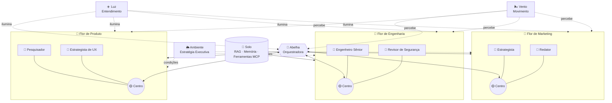

  🇺🇸 <a href="README.md">English</a> ·
  🇧🇷 <a href="readme-pt.md">Português</a> ·
  🇪🇸 <a href="readme-es.md">Español</a> ·
  🇳🇱 <a href="readme-nl.md">Nederlands</a> ·
  🇩🇪 <a href="readme-de.md">Deutsch</a>

# 🌸 FOAA — Flower-Orchestrated Agent Architecture

> *Uma filosofia para coordenar muitos times, muitos agentes e muitos subagentes, aprendida com a natureza.*

**FOAA** (Flower-Orchestrated Agent Architecture, ou Arquitetura de Agentes Orquestrada por Flores) é uma forma de organizar sistemas autônomos de IA para que possam crescer sem cair no caos. Ela se apoia em cinco pilares:

**Governança · Coordenação · Conhecimento e Contexto · Autonomia Guiada · Observabilidade**

Este repositório contém a primeira **implementação em Python** do FOAA. Ela transforma a filosofia em algo que você pode executar, observar e questionar.

---

## 🌼 A Ideia

Imagine um campo cheio de flores.

Tanta coisa acontece ali que nem conseguimos ver. Por um instante esquecemos de tudo isso, envolvidos pela beleza do campo. Mas, por trás dessa beleza, o campo nunca para de trabalhar. As raízes tiram alimento do solo. As abelhas levam pólen de uma flor para a outra. O vento passa por tudo. O sol ilumina o campo inteiro.

Tire a luz do sol e o campo continua lá, mas já não conseguimos enxergá-lo direito. As flores continuam crescendo por um tempo com o que guardaram. Depois, aos poucos e sem que ninguém perceba, as coisas começam a dar errado.

Sistemas autônomos multiagentes se comportam do mesmo jeito. Eles podem funcionar por muito tempo sem visibilidade, sem coordenação e sem retorno. Tarefas são concluídas e mensagens são trocadas. Por baixo, pequenos erros se acumulam, os desvios se espalham e a atividade vira ruído.

O FOAA parte de uma pergunta:

> **Como a autonomia deve ser organizada para crescer sem perder a coerência?**

A resposta não é a desordem, nem a interação ilimitada entre agentes.
A resposta é a **orquestração**, e a natureza orquestra há milhões de anos.

> 📖 *Quer conhecer a abordagem filosófica por trás do FOAA? [Leia o livro na Amazon](https://a.co/d/0dV8GNbX).*

---

## 🌻 O Ecossistema

Cada parte do campo tem um papel na arquitetura.

| Na natureza | No FOAA | Responsabilidade |
|---|---|---|
| 🌸 **Flor** | Um time | Uma unidade auto-organizada, com propósito, coordenador e especialistas próprios. |
| 🟡 **Centro da flor** | O coordenador do time (agente Gerente de Produto / Projeto / Domínio) | Transforma objetivos em planos, delega o trabalho, reavalia os resultados e toma a decisão final local. |
| 🌺 **Pétalas** | Subagentes especialistas | Cada uma tem um papel claro e delimitado: engenheiro sênior, estrategista de marketing, revisor de segurança, analista financeiro... |
| 🌱 **Raízes** | RAG e memória | Absorvem conhecimento do solo. Com o tempo, a história ensina o sistema e torna a IA mais eficiente. |
| 🌿 **Galhos** | MCP | Conectam cada flor ao seu entorno: ferramentas, APIs, bancos de dados e serviços, acessados por caminhos governados. |
| 🐝 **Abelhas** | Orquestradores (Gerente de Programa) | Voam de flor em flor, pegando "pólen" e deixando pólen pelo caminho. Levam contexto e valor entre os times. |
| 🌦️ **Ambiente** | Estratégia executiva (C-level) | Sol, chuva, vento, tempestades e estações. Define as condições em que tudo cresce, como o maestro de uma orquestra. |
| 🌬️ **Vento** | Observador do movimento | Observa tudo o que se move: carga, desvios, novas tentativas, atritos, instabilidade. |
| ☀️ **Luz** | Observador do entendimento | Mostra o quadro mais "estático": decisões, evidências, qualidade, risco, custo e a saúde geral. |
| 👩‍🌾 **Jardineiro** | Cuidado humano | Prepara o solo, observa padrões e intervém quando é preciso, sem microgerenciar cada pétala. |

---

## 🌺 Os Princípios

### 1. O centro dá sentido, não microgerencia
O centro da flor não faz todo o trabalho. Ele explica **por que** o trabalho existe. Recebe um objetivo, divide em partes, entrega às pétalas e, quando as evidências voltam, **raciocina de novo**. Um centro que só repassa mensagens não acrescenta nada. Um centro que tenta fazer tudo vira gargalo. Um centro saudável fica entre os dois.

### 2. Pétalas são focadas, não diminuídas
Uma pétala não precisa virar a flor inteira. Cada especialista tem **autonomia delimitada**: liberdade real para raciocinar, dentro de limites claros sobre quais ferramentas, dados e ações pode usar. Uma pétala devolve mais do que uma resposta. Ela também devolve suas **evidências, riscos e incertezas**.

### 3. Raízes e galhos alimentam a inteligência
- **RAG (raízes)** responde: *O que esta flor precisa saber agora?*
- **MCP (galhos)** responde: *O que esta flor pode alcançar, usar ou acionar?*

O RAG alimenta o pensamento. O MCP alimenta a ação. O que o campo aprende volta ao solo, depois de filtrado e validado, para que a próxima estação cresça mais forte.

### 4. Abelhas levam continuidade, não controle
A abelha conversa com o **centro** da flor, nunca diretamente com as pétalas. Ela distribui o trabalho, define a ordem, traduz o contexto entre áreas, identifica conflitos e combina resultados que nenhuma flor conseguiria produzir sozinha. A abelha coordena as conexões entre as flores. Ela não assume o controle das flores.

### 5. O ambiente define as condições
Executivos não aprovam cada ação. Eles definem o **clima**: prioridades, apetite a risco, orçamentos, conformidade e padrões de qualidade. Assim, boas decisões locais acontecem naturalmente. A estratégia também aprende: quando muitas flores mostram o mesmo desgaste, o problema pode estar no clima, e não nas flores.

### 6. Observadores governam a percepção
> **Gerentes governam a ação. Observadores governam a percepção.**

O vento mostra o que está mudando e sob pressão. A luz mostra o que pode ser entendido. Os observadores **não fazem o trabalho**. Eles alertam, explicam e escalam, e o centro responsável decide o que fazer. Sem luz, o campo continua existindo, mas funciona no escuro.

### 7. O mesmo padrão em todas as escalas
O FOAA é **fractal**. Um gerente governa pétalas. Uma abelha governa flores. Flores de nível mais alto governam programas. O ambiente governa o portfólio. O tamanho muda, mas a forma continua a mesma. Entre servidores e regiões, as flores se comunicam por **contratos orientados a eventos**, e não por dependências escondidas.

---

## 🐍 Este Repositório

`foaa-python` é a implementação de referência do FOAA, ainda **em fase inicial de desenvolvimento**. O objetivo é transformar cada elemento do campo (centros, pétalas, raízes, galhos, abelhas, ambiente, vento e luz) em blocos práticos e observáveis para sistemas multiagentes reais.

Fique de olho: módulos, exemplos e documentação vão crescer aqui, estação após estação. 🌱

---

## 📖 O Livro

A filosofia completa, a arquitetura e o raciocínio por trás do FOAA estão no livro:

**_Flower-Orchestrated Agent Architecture (FOAA): Governance, Architecture, and the Future of Autonomous Systems_**
de **Anderson Matheus Arruda**.

🌿 **Quer se aprofundar na filosofia por trás do FOAA?** Leia o livro na Amazon: **[Flower-Orchestrated Agent Architecture](https://a.co/d/0dV8GNbX)**

> O livro é protegido por direitos autorais e **não** está incluído neste repositório.

---

## 🌞 Um Dia no Campo: Uma História

*A história a seguir mostra o ecossistema funcionando bem, da primeira luz da manhã até o anoitecer.*

### Amanhecer: O Clima É Definido

Antes que a primeira pétala se abra, o **ambiente** já decidiu que tipo de estação será esta.

Neste trimestre, a liderança de uma pequena empresa de software escolheu uma direção: *"Facilitar para os clientes pagarem por ano em vez de por mês. Crescer, sem deixar custos nem segurança escaparem."*

Ninguém recebe ordem sobre qual código escrever ou qual slogan usar. Os executivos apenas definem o clima: um orçamento, um prazo, um padrão rígido de segurança e um recado claro de que experimentar é bem-vindo, desde que tudo continue visível.

O sol nasce sobre o campo.

### Manhã: A Abelha Levanta Voo

Um novo objetivo chega ao ecossistema: **"Lançar planos de assinatura anual."**

A **abelha** assume a missão. Ela não sabe construir um sistema de cobrança nem escrever uma campanha, e nem precisa. O que ela sabe é *quem* no campo pode ajudar, e em que ordem.

Antes de voar, ela busca nas **raízes**. O RAG traz algo valioso: três meses atrás, outra abelha coordenou uma mudança de preços, e a flor de engenharia teve um problema no cálculo de impostos para clientes de outros países. O solo lembra. A abelha anota: *"Perguntar sobre impostos internacionais logo no início."*

Então ela voa até três flores:

- Para a **Flor de Produto**: *"O que os clientes realmente esperam de um plano anual?"*
- Para a **Flor de Engenharia**: *"O que é preciso para oferecer cobrança anual com segurança?"*
- Para a **Flor de Marketing**: *"Como vamos contar essa história quando estiver pronta?"*

A abelha nunca fala diretamente com uma pétala. Ela pousa em cada **centro**, deixa seu pólen (o contexto, as restrições, a anotação sobre impostos) e segue adiante.

### Meio-dia: As Flores Desabrocham

Na **Flor de Produto**, o centro lê o pedido e dá sentido a ele. Envia uma *pétala de Pesquisa* para estudar o feedback dos clientes e uma *pétala de Estratégia de UX* para desenhar o fluxo de upgrade. As duas voltam com suas descobertas **acompanhadas de evidências**: "Os clientes querem um desconto claro e querem saber que podem cancelar." O centro pondera as duas respostas, percebe que elas concordam e publica sua decisão: **dois meses grátis, com cancelamento claramente permitido.**

Na **Flor de Engenharia**, o centro divide o trabalho. Uma *pétala de Engenheiro Sênior* projeta a mudança na cobrança. Uma *pétala de Revisão de Segurança*, com acesso somente leitura porque seus limites assim determinam, inspeciona o fluxo de pagamento. Pelos **galhos**, as pétalas alcançam o repositório, o ambiente de testes do provedor de pagamentos e o pipeline de CI, tudo por conexões MCP governadas. Nada toca a pasta de segredos. Nada vai para produção sem revisão.

A pétala de Segurança traz um achado: *"Risco médio: reembolsos de planos anuais ainda não são tratados."* Ela não esconde a incerteza. Ela dá nome a ela.

O centro de engenharia **raciocina de novo**. Com a nova evidência, o plano muda: o tratamento de reembolsos passa a fazer parte do escopo. É o centro fazendo seu trabalho, reconstruindo seu entendimento depois que os especialistas mudaram o que a flor sabe.

Na **Flor de Marketing**, uma *pétala de Estratégia* espera de propósito. O centro dela sabe que anunciar algo antes de existir de verdade quebraria a regra do clima: crescer, mas com honestidade.

### Tarde: O Vento Sopra

Uma brisa atravessa o campo.

O **vento** percebe algo: os testes da Flor de Engenharia estão sendo executados de novo, e de novo. A latência está subindo. Duas vezes em uma hora, o mesmo teste de integração falha, passa e falha de novo.

O vento não conserta nada. Esse não é o papel dele. Ele simplesmente torna o movimento visível: *"Instabilidade detectada na Flor de Engenharia: tentativas repetidas na integração de impostos."*

Então a **luz** entra em cena. Como cada ação foi registrada, com qual flor agiu, qual pétala, qual contexto e qual ferramenta, a luz consegue mostrar o que realmente está acontecendo. Os testes que falham estão usando uma **tabela de impostos desatualizada** do solo, o mesmo tipo de problema que as raízes tinham lembrado de manhã.

Agora todos conseguem *ver*.

- O **centro de engenharia** pausa a tarefa e pede às pétalas que usem a fonte atualizada.
- A **abelha** verifica as outras flores e confirma que Produto e Marketing não foram afetados.
- A **governança** marca a tabela antiga como obsoleta, para que nenhuma flor volte a beber dela.
- O **jardineiro**, um engenheiro humano, revisa a correção, aprova e volta para o seu café.

Sem pânico. Sem culpados. Só sinal, entendimento, decisão e correção.

### Fim de Tarde: Polinização

Com a engenharia estável e as decisões de produto tomadas, a abelha voa de novo. Desta vez ela carrega **resultados** em vez de pedidos.

Ela leva o preço final e a política de reembolso para a **Flor de Marketing**. Agora a pétala de Estratégia trabalha, e uma *pétala de Redação* se junta a ela. Juntas, escrevem uma mensagem clara, honesta e coerente com o que a engenharia realmente construiu: *"Pague por ano, ganhe dois meses grátis, cancele quando quiser."*

A abelha reúne os três resultados e os combina em algo que nenhuma flor teria produzido sozinha: **uma funcionalidade funcionando, um preço validado e uma mensagem de lançamento que diz a verdade.**

Ela envia o resultado ao ambiente. Os executivos têm uma visão única e clara: o custo ficou dentro do orçamento, a segurança revisou as partes arriscadas, um incidente foi detectado e corrigido, e o lançamento está pronto.

### Anoitecer: O Solo Lembra

Quando o sol se põe, o campo não esquece o que viveu.

As decisões validadas, a fonte de impostos corrigida e a lição *"planos anuais precisam tratar reembolsos"* voltam para o **solo**. Nem tudo é guardado. O ruído, os rascunhos temporários e as tentativas que falharam ficam para trás. Só o que foi **validado** vira memória.

Na próxima estação, quando outra abelha coordenar outro lançamento, as raízes vão buscar no solo e encontrar este dia esperando por elas, pronto para deixar o campo um pouco mais sábio.

E em algum lugar além do campo, as pessoas que usam o produto simplesmente percebem uma nova opção: *pague por ano, economize mais.* Elas nunca vão ver as abelhas, as pétalas, o vento ou a luz.

É assim que deve ser.

**Um campo saudável não pede para ser admirado pelas suas engrenagens. Ele simplesmente floresce.** 🌸

---

## 📜 Licença

O código-fonte deste repositório é distribuído sob a [Licença MIT](LICENSE).

O livro *Flower-Orchestrated Agent Architecture (FOAA)* **não** está coberto por esta licença. Ele continua © Anderson Matheus Arruda, todos os direitos reservados.

---

## 👤 Autor

**Anderson Matheus Arruda**: engenheiro de software e estrategista técnico, com mais de duas décadas de experiência em sistemas distribuídos, nuvem, dados, IA e arquiteturas de agentes autônomos.

- GitHub: [andmarruda/foaa-python](https://github.com/andmarruda/foaa-python)
- LinkedIn: [anderson-a-sborg](https://www.linkedin.com/in/anderson-a-sborg/)

---

<i>Inteligência sem orquestração não vira sabedoria. Vira ruído. O FOAA existe para transformar ruído em vida organizada.</i>

